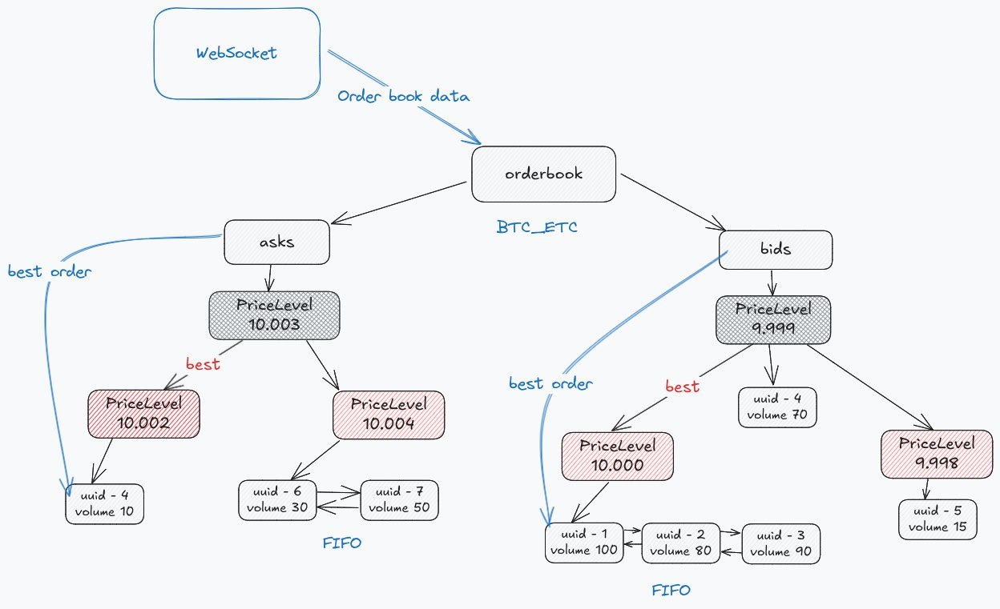

# Order Matching Engine

## Description
An **high-performance**, **low-latency** order matching engine designed to process orders in from external API. The engine maintains order books using Red-Black (RB) trees for optimized O(log N) search and linked lists for **FIFO** execution. The system is scalable and can be integrated with external services via **gRPC streaming** or message brokers.

### Key Features:
- Implements an order book with **price-time priority**
- Uses **Red-Black trees** for efficient searching and order management
- **O(1) best order lookup** through linked nodes in the tree
- **FIFO order execution** within each price level
- **Aggressive order execution** upon arrival if a price match exists
- **Passive order addition** when no immediate match is available
- **gRPC streaming** to notify external services upon order match
- **O(log N) search time complexity** for locating specific orders, ensuring fast modifications and deletions

All tests, including benchmark tests, are available in the `tests` folder.



## Orderbook Mechanics
The order matching engine processes orders from **CoinAPI via WebSocket**. For each token pair, two **Red-Black trees (RB trees)** are created:
- **Bids Tree** (Buy Orders): Stores buy orders, sorted by price in descending order.
- **Asks Tree** (Sell Orders): Stores sell orders, sorted by price in ascending order.

### Order Processing
- **RB Trees for Efficient Search:** The RB tree structure allows searching for a specific price level or modifying/deleting an order in **O(log N) time**.
- **Best Order Tracking:** Each tree maintains a reference to the **best order**:
  - **Asks Tree:** The best order is the one with the lowest price.
  - **Bids Tree:** The best order is the one with the highest price.
  - This allows for constant-time (O(1)) retrieval of the best available price.
- **Linked Lists for FIFO Execution:** Each node (price level) in the RB tree contains a **linked list of orders** at that price to ensure:
  - **FIFO (First In, First Out) execution**.
  - **O(1) addition of new orders** at a given price level.

### Matching Logic
1. **Aggressive Orders:** If an incoming order has a price that is **better than the best available price**, it is executed immediately.
   - If the order is only partially filled, the next best order is selected and execution continues.
   - This ensures that aggressive orders are processed efficiently, filling as much volume as possible.
2. **Passive Orders:** If an order does not immediately match an existing order, it is simply added to the order book in its respective RB tree.
3. **gRPC Notifications:** Whenever an order match occurs, order details are streamed via **gRPC** to an external service (e.g., a notification service).

## Perfomance
About 275 thousand orders were processed in ~1.8 sec, including additions, status updates, and random deletions, so we process approximately 150k orders per 1 second.

The engine has been benchmarked with the following results:
```aiignore
go test ./internal/orderbook/tests -run=^$ -bench=BenchmarkPerformanceWithUpdate -count=10
goos: linux
goarch: amd64
pkg: order-service/internal/orderbook/tests
cpu: 11th Gen Intel(R) Core(TM) i7-1165G7 @ 2.80GHz
BenchmarkPerformanceWithUpdate-8               1        1969563363 ns/op        38842496 B/op    1447349 allocs/op
BenchmarkPerformanceWithUpdate-8               1        2054449095 ns/op        38837312 B/op    1447346 allocs/op
BenchmarkPerformanceWithUpdate-8               1        1820713893 ns/op        38831648 B/op    1447337 allocs/op
BenchmarkPerformanceWithUpdate-8               1        1794104408 ns/op        38831632 B/op    1447336 allocs/op
BenchmarkPerformanceWithUpdate-8               1        1753715310 ns/op        38831728 B/op    1447337 allocs/op
BenchmarkPerformanceWithUpdate-8               1        1818219918 ns/op        38832592 B/op    1447347 allocs/op
BenchmarkPerformanceWithUpdate-8               1        1820063659 ns/op        38830832 B/op    1447324 allocs/op
BenchmarkPerformanceWithUpdate-8               1        1835274567 ns/op        38832016 B/op    1447339 allocs/op
BenchmarkPerformanceWithUpdate-8               1        1826892197 ns/op        38831856 B/op    1447337 allocs/op
BenchmarkPerformanceWithUpdate-8               1        1817778116 ns/op        38832496 B/op    1447345 allocs/op
PASS
ok      order-service/internal/orderbook/tests  18.532s
```

### Memory Allocations in Benchmark Match Case (3 Passive Orders + 1 Aggressive Order Match)
See, that is a standard case (insert 3 passive bid orders, then insert one aggressive ask order that matches 2 bid orders) we get a total of 7 memory allocations:
- 3 Allocations for Bid Orders as a new instance of the *orderbook.Order struct.
- 3 Allocations for Tree Nodes in a RBTree for different prices
- 1 Allocation for the OrderList: When a new node is created, a new OrderList is allocated to store the orders for that specific price level.

```aiignore
go test ./internal/orderbook/tests -run=^$ -bench=BenchmarkOrderMatch -benchmem 
goos: linux
goarch: amd64
pkg: order-service/internal/orderbook/tests
cpu: 11th Gen Intel(R) Core(TM) i7-1165G7 @ 2.80GHz
BenchmarkOrderMatch-8            3514737               365.7 ns/op           328 B/op          7 allocs/op
PASS
```